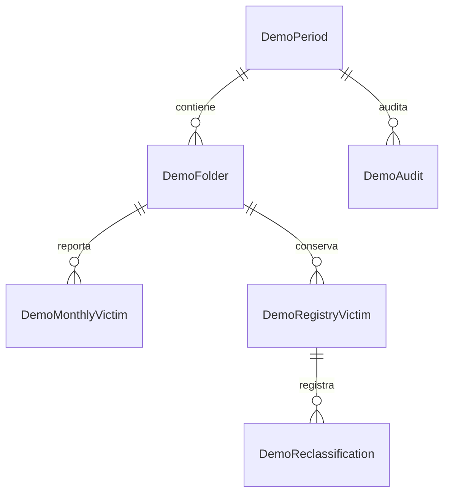

# SIIID · Modelo relacional de laboratorio

**SQL Server 2019+ · Integridad referencial · Transacciones · Historial · Concurrencia**

Modelo independiente de portafolio con carpetas y víctimas ficticias, un mensual, un registro BANCI y reclasificación reversible por víctima. No contiene exportaciones del sistema, catálogos oficiales, usuarios SQL, contraseñas, respaldos ni rutas de servidores.

## Relación con los otros componentes

| Repositorio | Responsabilidad |
|---|---|
| [SIIID2.FrontEnd-Portfolio](https://github.com/gerardomelkart/SIIID2.FrontEnd-Portfolio) | Interfaz con ocho escenarios guiados |
| [SIIID.API-Portfolio](https://github.com/gerardomelkart/SIIID.API-Portfolio) | Reglas ejecutables en memoria y contrato HTTP |
| **SIIID2BD-Portfolio** | Ejemplo SQL de almacenamiento, restricciones y reclasificación transaccional |

La API pública funciona en memoria y **no ejecuta estos scripts ni se conecta a esta base**. Este repositorio muestra por separado cómo modelar la persistencia. No incluye procedimientos de importación, staging, aprobación ni conciliación mensual: esas reglas están demostradas en la API.

## Instalación en laboratorio

En una instancia local de SQL Server 2019 o superior, crea una base vacía desde SSMS con una cuenta autorizada:

```sql
CREATE DATABASE [SIIID_PORTFOLIO];
```

Después abre y ejecuta los siguientes scripts en este orden:

1. `sql/01_schema.sql`: seis tablas, restricciones, índice y vista de desapariciones vigentes.
2. `sql/02_reclassify.sql`: procedimiento transaccional de reclasificación y reversión.
3. `sql/03_synthetic_data.sql`: corte septiembre 2026, una carpeta y dos víctimas ficticias.
4. `sql/04_checks.sql`: reclasifica, comprueba y revierte dentro de una transacción; termina con `ROLLBACK` para conservar el ejemplo inicial.

Los scripts seleccionan explícitamente `SIIID_PORTFOLIO`. No incluyen credenciales ni crean usuarios. `01` no reemplaza el modelo si ya existe y `03` rechaza un corte repetido. No son migraciones incrementales.

## Modelo



Las claves compuestas incluyen el periodo para aislar cortes. Dos víctimas pueden compartir una carpeta. BANCI referencia la carpeta histórica y no la fila mensual, de modo que retirar una reclasificada del mensual no obliga a eliminar su histórico. La vista `vw_DemoActiveDisappearance` excluye `OTRO` y `NO_DELITO`.

## Ejemplo individual y reversible

Después de instalar los datos sintéticos:

```sql
EXEC dbo.usp_DemoReclassify
    @Period = '2026-09', @VictimId = 'DEMO-V001',
    @NewOffense = 'NO_DELITO', @Reason = N'Motivo ficticio',
    @ExpectedRevision = 0;

SELECT * FROM dbo.vw_DemoActiveDisappearance;
-- Solo DEMO-V002 permanece vigente. El mensual conserva ambas filas.

EXEC dbo.usp_DemoReclassify
    @Period = '2026-09', @VictimId = 'DEMO-V001',
    @NewOffense = 'DESAPARICION', @Reason = N'Reversión ficticia',
    @ExpectedRevision = 1;

SELECT * FROM dbo.DemoReclassification ORDER BY EventId;
```

El procedimiento bloquea la fila del periodo con `UPDLOCK, HOLDLOCK`, exige la revisión esperada e integra estado, evento y auditoría en una transacción. Una revisión obsoleta produce error. No modifica el mensual ni otras víctimas. Las cuentas con escritura directa pueden saltarse la bitácora: no es una auditoría inalterable ni una implementación de permisos de producción.

## Validación y límites

Los scripts se revisaron estáticamente. No se afirma haberlos ejecutado contra una instancia SQL Server en esta publicación. `04_checks.sql` permite realizar esa comprobación en laboratorio. La ejecución de la API y su Front se verifica por separado y no certifica esta integración SQL, que no está implementada.

No se concede una licencia de reutilización por el solo hecho de ser público.
